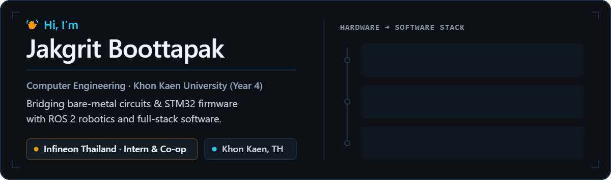
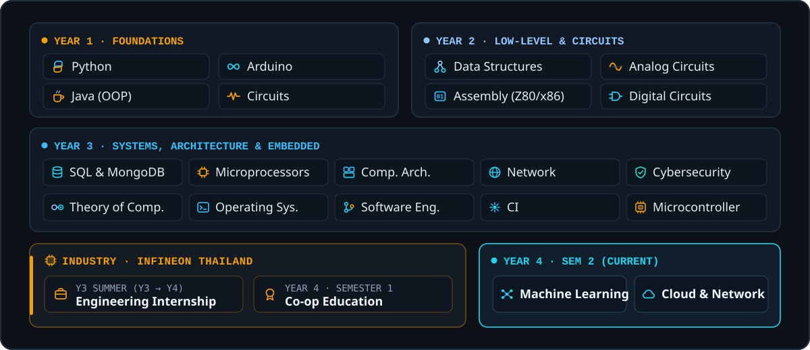
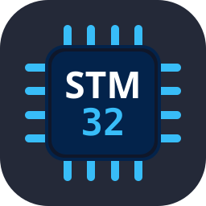
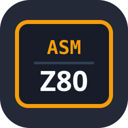
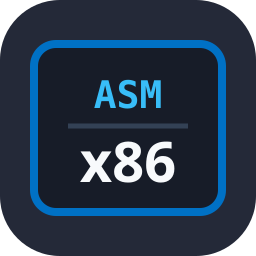
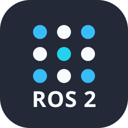

  

  
  
  

### Featured Projects

-  &nbsp;**[WRG ROS 2025](https://github.com/JakgritB/WRG-ROS-Challenge-2025)** — Autonomous TurtleBot3 navigation with ROS 2, SLAM, Nav2 & YOLOv8
-  &nbsp;**[MT Car Sim (STM32)](https://github.com/JakgritB/Nexty-STM32-Training)** · [Demo ↗](https://www.youtube.com/watch?v=KjPS97JEyH0) — STM32 HAL & bare-metal firmware (GPIO, UART, Timers, PWM)
-  &nbsp;**[Cat Hotel](https://github.com/JakgritB/CatHotelProject)** · [Demo ↗](https://www.youtube.com/watch?v=1HrHpbMARmw) — Pet boarding & live status web app (`Next.js`, `MongoDB`)

### Experience & Coursework

  

### Skills

  
  
  
  
  
  
  
  
  
   
  
  
  
  
  
  
  
  
  

### GitHub Stats

  
  

> **Balanced Language Weighting:** $\text{score} = \sqrt{\text{size} \times \text{count}}$  
> Top Languages balances code size with repository count (excluding generated build files & notebooks) so large vendored libraries or small config files don't distort the actual languages written.

 

  

